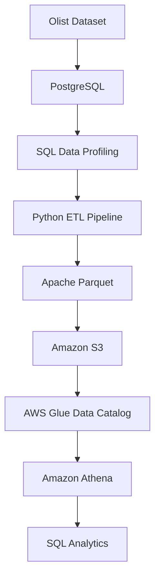

# Local-to-Cloud Data Migration Pipeline

A hands-on data engineering project that demonstrates how to extract, transform, validate, and migrate relational data from a local PostgreSQL database to AWS cloud storage, then query the migrated data using Amazon Athena.

## 1. Project Overview

This project implements a batch ETL pipeline using Python to migrate Brazilian E-Commerce (Olist) data from PostgreSQL into Amazon S3 in Apache Parquet format.

The migrated datasets are registered as external tables in AWS Glue Data Catalog and queried using Amazon Athena.

**Key objectives:**
- Perform data profiling and quality validation.
- Build a Python-based ETL pipeline.
- Convert processed datasets into Parquet format.
- Upload data to Amazon S3 using AWS SDK for Python (Boto3).
- Query cloud-hosted datasets using Amazon Athena.

## 2. Architecture



## 3. Technology Stack

| Category | Technology |
|---|---|
| Database | PostgreSQL |
| Programming | Python |
| Data Processing | Pandas |
| Database Connectivity | SQLAlchemy |
| Storage Format | Apache Parquet |
| Cloud Storage | Amazon S3 |
| AWS SDK | Boto3 |
| Metadata Catalog | AWS Glue Data Catalog |
| Query Engine | Amazon Athena |
| Development Tools | pgAdmin, AWS Console, VS Code |

## 4. Dataset

The project uses the Olist Brazilian E-Commerce dataset.

Three relational tables were selected:

| Table | Records | Description |
|---|---:|---|
| customers | 9,941 | Customer information |
| orders | 9,941 | Order transaction information |
| order_items | 112,650 | Individual order items and pricing |

**Total records: 132,532**

## 5. Data Engineering Workflow

### Step 1 — Data Ingestion and Profiling

Imported the selected Olist datasets into PostgreSQL.

Performed data quality checks, including:
- Missing value detection.
- Duplicate record detection.
- Primary and foreign key validation.
- Referential integrity checks.
- Invalid price and delivery date checks.

### Step 2 — Processed Data Layer

Created a dedicated `processed` schema in PostgreSQL.

Applied:
- Primary key constraints.
- Foreign key constraints.
- Relational integrity validation.
- Record count verification.

### Step 3 — Python ETL Pipeline

Developed a Python ETL pipeline using Pandas and SQLAlchemy.

**Extract**
- Connected Python to PostgreSQL.
- Retrieved data from the processed schema.

**Transform**
- Standardized text fields by trimming whitespace.
- Prepared datasets for downstream storage.

**Validate**
- Checked empty datasets.
- Validated primary key null values.
- Detected duplicate primary keys.
- Verified record count consistency.

**Load**
- Exported processed datasets into Apache Parquet files.
- Verified the generated files by reading them back.

Logging was implemented to record pipeline execution and errors.

### Step 4 — AWS S3 Migration

Used Boto3 to upload the generated Parquet files to Amazon S3.

Implemented an IAM user with restricted S3 permissions following the principle of least privilege.

S3 storage structure:

```text
processed/
├── customers/
│   └── customers.parquet
├── orders/
│   └── orders.parquet
└── order_items/
    └── order_items.parquet
```

### Step 5 — AWS Athena Integration

Configured Amazon Athena to query the Parquet datasets stored in S3.

- Created the `olist_db` database.
- Registered three external tables.
- Used AWS Glue Data Catalog for table metadata.
- Configured an S3 query results location.
- Executed record count validation and SQL JOIN queries.

## 6. Validation Results

| Validation | Result |
|---|---|
| PostgreSQL source ingestion | Successful |
| Data quality checks | Passed |
| Processed schema constraints | Applied |
| Python ETL execution | Successful |
| Parquet generation | 3 files created |
| S3 migration | Successful |
| Athena external tables | 3 tables registered |
| Record count verification | Matched |
| Cross-table SQL JOIN | Successful |

## 7. Key Technical Challenges

**Parquet and Athena schema mismatch**

During Athena integration, a data type mismatch occurred between the Parquet physical schema and the Athena table definition.

The `price` and `freight_value` columns were stored as `DOUBLE` in Parquet, while the initial Athena metadata expected `DECIMAL(12,2)`.

The immediate issue was resolved by aligning the Athena table definitions with the actual Parquet data types.

For production-oriented improvements, preserving decimal precision throughout the ETL process is recommended.

## 8. Limitations and Future Improvements

Potential improvements include:

- Preserve decimal precision during data extraction and Parquet generation.
- Implement incremental data loading.
- Add automated retries and failure recovery.
- Introduce ETL orchestration using Apache Airflow or AWS-native services.
- Implement automated data quality monitoring.
- Improve pipeline observability and alerting.

## 9. Project Structure

```text
olist-cloud-migration/
├── data/
│   └── processed/
├── logs/
├── src/
│   ├── etl.py
│   └── upload_s3.py
├── sql/
│   ├── create_database.sql
│   ├── create_tables.sql
│   └── analytics_queries.sql
├── .env.example
├── .gitignore
├── requirements.txt
└── README.md
```

## 10. How to Run

### Prerequisites
- Python 3.x
- PostgreSQL
- AWS account with access to Amazon S3 and Athena
- IAM credentials with appropriate S3 permissions

### Installation

```bash
git clone <repository-url>
cd olist-cloud-migration

python -m venv .venv
```

Activate the virtual environment and install dependencies:

```bash
pip install -r requirements.txt
```

### Environment Configuration

Create a `.env` file using `.env.example` as a reference.

Configure PostgreSQL and AWS credentials locally. Never commit `.env` or secret credentials to GitHub.

### Run the ETL Pipeline

```bash
python src/etl.py
```

### Upload to S3

```bash
python src/upload_s3.py
```

### Query with Athena

Execute the SQL scripts in the `sql/` directory using Amazon Athena Query Editor.

## 11. Key Takeaways

This project provided hands-on experience with relational databases, SQL-based data profiling, Python ETL development, columnar storage formats, AWS cloud storage, IAM permissions, metadata management, and serverless SQL querying.

It demonstrates an end-to-end batch data migration workflow from a local database to cloud-based analytics storage.